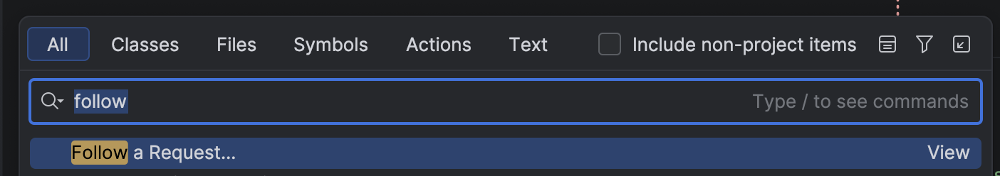
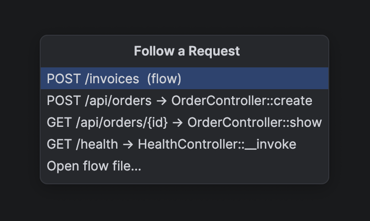

# CodeLanes

[](https://github.com/agitri/codelanes/actions/workflows/ci.yml)
[](https://plugins.jetbrains.com/plugin/35151-codelanes)
[](https://plugins.jetbrains.com/plugin/35151-codelanes)

**Read code like a human.** CodeLanes is a plugin for PhpStorm and IntelliJ IDEA that replaces the vertical, line-by-line
editor with a canvas of real, editable code blocks laid out in lanes: what a class builds on on the left, the class
in the middle, its methods on the right, connected by colour-coded lines.


## Why

More and more code is written by AI, and more and more of it gets skimmed instead of understood. A long
file read top to bottom hides its structure: which interface does this method satisfy, which methods call
each other, what does this class actually depend on?

CodeLanes cuts a class into digestible blocks and puts the structure on screen, so that the developer
who has to own the code really reads it. It is a **viewer and editor**, not an explainer: no AI, no
summaries, everything comes from the real code.


## What you get

- **The canvas is the editor.** Every block is a real IDE editor showing one slice of the file:
  completion, inspections, refactorings and undo all work. The file on disk stays plain PHP or Java, so git, your
  team and your tools see nothing unusual.
- **Lanes, not a mess.** Parents, interfaces, traits and injected dependencies each get their own lane in a
  staircase left of the class. The class (with a collapsed `namespace`/`use` header above it) sits in the
  middle, and its methods sit in a lane on the right. Methods that call each other are grouped together.
- **Colour-coded lines:** extends, implements, uses trait, injected, has method, calls, overrides. A legend
  in the corner explains them. Call and override lines only show for the block you are working in, so the
  canvas stays calm. Lines go around blocks instead of through them.
- **Who implements this?** Open an interface, trait or abstract class and you also see the classes that
  implement, use or extend it, plus the methods they implement.
- **Follow the code.** Cmd/Ctrl+click jumps to the right block instead of leaving the canvas. With the caret on
  a symbol, the block that defines it gets an orange border and every block using it a yellow one.
- **Follow a request.** **View → Follow a Request…** lists the routes in your project (`#[Route]` attributes and
  `config/routes` YAML/XML files, e.g. `POST /api/orders → OrderController::create`). Pick one and the whole chain it runs (controller, services,
  repositories, through interfaces into their implementations) lands on one canvas.
- **Search and add.** **Add method…** (canvas toolbar) finds any method in your project and drops it on the
  canvas as an editable block, ready to follow with `+ calls`; right-click → **Remove from canvas** takes it off.
- **Follow the flow across files.** `+ calls` on a method puts the methods it calls in other classes on the
  canvas, as editable blocks; keep clicking `+ calls` to follow the flow deeper.
- **Review as you read.** Right-click a block's title to mark it **✓ Understood**, **? Don't understand** or
  **! Needs change**, or to add a note. Marks are saved in `.codelanes/review.json`, so you can commit them and
  review AI-written code together in a pull request. When the code changes after you marked it, the mark turns
  into a grey **~** ("changed since review").
- **Notes on the canvas.** **+ Note** (toolbar) adds a note card you type in directly; right-click its title to
  link it to blocks (dashed lines) or delete it. Notes and their positions are shared in `.codelanes/notes.json`,
  so a review summary sits right next to the code for everyone.
- **Working sets.** **View → CodeLanes Working Sets → Save Working Set…** saves every open canvas, including
  followed calls, revealed parents, collapsed blocks and zoom, under a name (e.g. "checkout flow") in
  `.codelanes/working-sets.json`. **Open Working Set…** brings it all back, also for a teammate.
- **Dig deeper.** `+ parents` on a parent, interface or trait shows its own parents, as deep as you like.
- **Edit the structure.** `+ method` on the class adds a method; right-click a method's title to delete it.
  Up/Down at the edge of a block moves into the next block.
- **Drag to arrange.** Your arrangement is remembered per file (just for you, not in git). **Tidy up** puts
  everything back in its lanes.
- **Safe editing.** Typing never ends up inside a hidden block. While the code is half-typed or broken, the
  canvas keeps the last good blocks instead of jumping around.


*Screenshots are from development builds; colours and details may differ slightly in the current version.*

## Install

Requirements: **PhpStorm 2025.2 or newer** for PHP, **IntelliJ IDEA 2025.2 or newer** for Java.
Works in PhpStorm (PHP) and IntelliJ IDEA (Java); other JetBrains IDEs aren't supported yet.

- **From the Marketplace:** in PhpStorm or IntelliJ IDEA, **Settings → Plugins → Marketplace**, search "CodeLanes" and click
  **Install**. Or open [CodeLanes on the JetBrains Marketplace](https://plugins.jetbrains.com/plugin/35151-codelanes)
  and click **Install**.
- **From source** (needs a **JDK 21+**; Gradle downloads the right toolchain):

  ```bash
  git clone https://github.com/agitri/codelanes.git
  cd codelanes
  ./gradlew buildPlugin
  ```

  Then in your IDE: **Settings → Plugins → ⚙ → Install Plugin from Disk…** and choose
  `build/distributions/codelanes-0.2.0.zip`. Restart the IDE.

## Use

- Open a PHP or Java file that contains one class, interface, trait, enum or record. It opens as a canvas.
- **Ctrl+Alt+Shift+B** (or **View → Toggle Blocks / Text View**) switches between the canvas and the classic
  text editor. The **Blocks | Text** tabs at the bottom of the editor do the same.
- Pan by dragging the background or scrolling; **Cmd/Ctrl+scroll** zooms.
- Click a block's title to collapse or expand it; drag the title to move it; right-click it for its menu.
- `+ method` (class title) adds a method; `+ parents` (parent/interface/trait title) reveals the next level.
- Up on a block's first line / Down on its last line moves into the neighbouring block.
- Shift+F6 inside a block opens the rename dialog.
- The toolbar in the bottom-left corner of the canvas switches the layout (**Lanes | Column | Tree**) and has
  **Follow a Request…**, **Working sets ▾** and **Tidy up** (forgets dragged positions). The same actions are in
  the View menu.
- **View → Open Files as Blocks by Default** turns the canvas on or off as the default.
- Files with several classes, top-level functions or loose code open as text, with a banner saying why.

**Follow a Request…** is also in Search Everywhere (press Shift twice and type "follow"). It lists the saved flows,
the routes it found, and **Open flow file…**:





## Flows from your AI assistant

Follow a Request finds Symfony routes by itself. For frameworks where the request takes paths the code doesn't spell
out (Laravel's `routes/web.php`, middleware, events and listeners, container bindings), let your AI assistant
describe the flow. CodeLanes checks every step against the real code and draws only what exists.


1. PhpStorm or IntelliJ IDEA 2025.2 or newer: enable **Settings → Tools → MCP Server** and connect your assistant (JetBrains AI
   Assistant/Junie, GitHub Copilot's agent mode, Claude Code, or any MCP client).
2. Ask it, for example: *"Show the flow of POST /invoices in CodeLanes."*
3. The assistant reads the code and calls the `codelanes_show_flow` tool. The canvas opens on the controller action
   with the flow on it:
   - **Solid lines** are proven by the code: the call is there, or the listener takes the event as its parameter.
   - **Dotted red lines** are only the AI's claim: both ends exist, but nothing in the code links them directly.
   - CodeLanes follows the ordinary calls from every step itself.
   - References that don't exist are never drawn. The assistant is told which ones, so it can fix them.
4. The first time, CodeLanes asks where to save the flow. Use `.codelanes/flows/` to share it with your team through
   git, or a git-ignored folder to keep it to yourself. The flow then shows up in **Follow a Request…**, no AI needed,
   and is checked against the code again every time it opens.


The AI never writes or explains code here; it only points at methods that exist.

## Java and Spring

In IntelliJ IDEA, a `.java` file with one class, interface, enum, record or annotation opens as a canvas, with the
same lanes and lines as PHP:

| In the Java code | Lane |
|---|---|
| `extends Base` | parent |
| `implements Foo`, or the interfaces an interface extends | interface |
| injected beans: constructor parameters, `@Autowired`/`@Inject`/`@Resource` fields, Lombok `@RequiredArgsConstructor` and `@AllArgsConstructor` fields | dependency |
| the class itself, with annotations and Javadoc | middle |
| each method | methods, on the right |

- JDK types are left out of the dependency lane. A library type without source (say `JpaRepository`) shows its name
  and methods only.
- An overloaded method gets its parameters in its id, so flows can tell them apart:
  `com.acme.shop.order.OrderService::place(String,int)`. A method with a unique name needs no parameters.
- AI flows use dots in Java references (`com.acme.shop.order.OrderController::create`). `binds` (interface to bean),
  `dispatches` (`publishEvent(new OrderPlaced(…))`) and `listens` (`@EventListener`) are proven from the code.
- **Follow a Request** lists Spring routes in a later version. Until then, ask your AI assistant for Spring flows.

Try it in [`playground/java-spring`](playground/java-spring), a small Spring-style shop that opens without Maven or Gradle.

## Status

Usable for reading and editing PHP and Java classes. Next up: Spring routes in Follow a Request, then
JAX-RS/Micronaut, Kotlin and TypeScript, and VS Code later. See [docs/roadmap.md](docs/roadmap.md).

## Develop

```bash
./gradlew test      # unit and platform tests
./gradlew runIde       # sandbox IntelliJ IDEA with the plugin: open playground/java-spring as its own project
./gradlew runPhpStorm  # sandbox PhpStorm with the plugin, for the PHP side
```

The sandbox IntelliJ IDEA has the PHP plugin installed but can't run it without an Ultimate licence, so try PHP in
`runPhpStorm`.

PHP and Java support live in the `php/` and `java/` Gradle modules. They are content modules: each is loaded only
when the IDE has that language, with its own class loader. A content module only sees the main jars of the plugins it
depends on, not their own content modules, and the tests don't catch that (they run on one class path). So use the
platform's searches (`DefinitionsScopedSearch`) over the Java plugin's own (`ClassInheritorsSearch`,
`OverridingMethodsSearch`), which moved into a content module in 2026.1, and try a change in the sandbox IDE.

CI runs on every push to `main` and every pull request:
- the tests and the plugin build;
- the plugin verifier against PhpStorm and IntelliJ IDEA 2025.2, 2025.3, 2026.1 and 2026.2;
- [Qodana](https://www.jetbrains.com/qodana/), JetBrains' inspections over the whole project.

Qodana fails on any problem that isn't in `qodana.sarif.json`, the problems already there when CI was added. To run
it locally (needs Docker):

```bash
docker run --rm -v "$PWD":/data/project jetbrains/qodana-jvm-community:2026.1 --baseline qodana.sarif.json
```

The design and the implementation plans live in [`docs/superpowers`](docs/superpowers).

## License

[MIT](LICENSE) © 2026 Rene Gerrits
